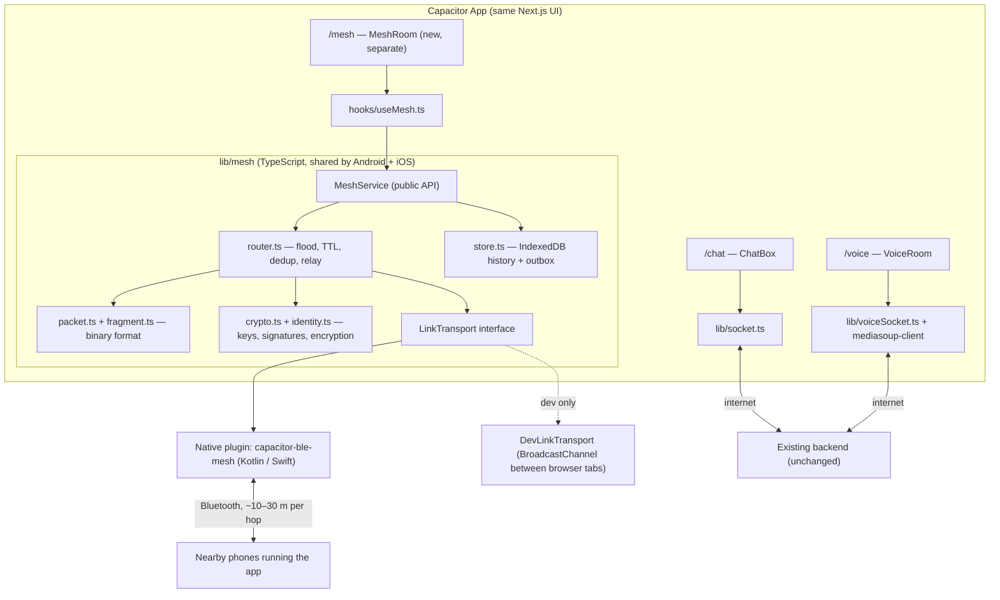

# Offline BLE Mesh Channel — Implementation Plan

A third channel, next to **Text Chat** (Socket.IO) and **Voice/Video** (mediasoup WebRTC): **Mesh**, a text-only channel that works with **no internet and no server at all**. Phones talk to each other directly over Bluetooth Low Energy (BLE) and relay messages for each other, the same way Bitchat does.

Goal: text communication keeps working where mobile networks are down or jammed.

---

## 1. Scope

| | Text Chat | Voice / Video | **Mesh (new)** |
| :--- | :--- | :--- | :--- |
| Route | `/chat` | `/voice` | `/mesh` |
| Transport | Socket.IO → backend | WebRTC → mediasoup SFU | BLE, phone to phone |
| Needs internet | Yes | Yes | **No** |
| Needs backend | Yes | Yes | **No** |
| Runs in browser | Yes | Yes | **No — native app only** (Capacitor) |
| Content | Text, reactions | Audio, video | Text only (public room + DMs) |

**Out of scope:** voice or video over mesh (BLE is far too slow), mesh in a plain browser or PWA (browsers can't make a phone announce itself over BLE), and reactions in v1.

**Limit to know:** a jammer that also covers **2.4 GHz** blocks BLE too. For that case the only fix is a different radio band (LoRa hardware). See §11.

---

## 2. Architecture



**Main design rule:** the native plugin stays thin. It only finds nearby phones, connects to them, and sends and receives raw bytes. All mesh logic (packets, routing, encryption, storage) lives in TypeScript, so it's written once, works on both platforms, and can be tested in a browser.

---

## 3. What changes in the existing code

**Rule: Text Chat and Voice are not changed.** The mesh is added next to them, not built into them. The full rules and how to check them are in §12.

**Never edited by this work:**
- `frontend/components/ChatBox.tsx`, `frontend/components/VoiceRoom.tsx`
- `frontend/lib/socket.ts`, `frontend/lib/voiceSocket.ts`, `frontend/hooks/useAuthSocket.ts`
- `frontend/app/chat/*`, `frontend/app/voice/*`, `frontend/app/page.tsx` (login)
- **The whole `backend/`** — routes, socket gateway, Redis streams, workers, mediasoup, and the DB schema

**The only edits to existing files (all additive):**

| File | Change | Why it can't affect chat/voice |
| :--- | :--- | :--- |
| `frontend/components/AppShell.tsx` | Add one `<Link href="/mesh">` rail icon after the Voice icon. Add an optional `allowOffline?: boolean` prop, **default `false`**, that skips the login redirect. | Chat and Voice don't pass the prop, so they behave exactly as now. The icon is just a link. |
| `frontend/next.config.ts` | `output: process.env.BUILD_TARGET === "capacitor" ? "export" : undefined` | The normal web build (`npm run build` / `npm run dev`) is unchanged. Static export only happens in the app build. |
| `frontend/package.json` | Add dependencies (`@capacitor/*`, `@noble/*`, `idb`, and `cross-env` so the env var also works on Windows) and one script: `"build:app": "cross-env BUILD_TARGET=capacitor next build && cap sync"`. | Existing scripts stay the same. The new packages are only imported by mesh files, so Next.js keeps them out of the chat and voice bundles. |

**New, separate files:** everything under `app/mesh/`, `components/mesh/`, `hooks/useMesh.ts`, `lib/mesh/` and `plugins/capacitor-ble-mesh/` (see §4).

**Backend URL in the app:** no code change. The `localhost:4000` fallback in `page.tsx` and `ChatBox.tsx` stays. The app build sets `NEXT_PUBLIC_API_URL` / `NEXT_PUBLIC_SOCKET_URL` to the real HTTPS server through an env file (`.env.capacitor`), so the fallback is never used there.

**On the website** (not the native app), the Mesh icon still shows but opens a "Mesh works in the mobile app" screen. Check this with `Capacitor.isNativePlatform()`.

---

## 4. New files

```
frontend/
├── app/mesh/page.tsx                    ✅ Phase 1
├── components/icons/MeshIcon.tsx        ✅ plain SVG, so AppShell imports nothing from mesh/
├── components/mesh/                     ✅ mesh-only UI; ChatBox is not refactored
│   ├── MeshRoom.tsx                     # page layout, intro card, status pill
│   ├── MeshMessageList.tsx              # styled to match ChatBox, but its own code
│   ├── MeshComposer.tsx
│   ├── MeshSidebar.tsx                  # you, nearby peers, simulator controls, stats
│   └── meshUi.ts
├── hooks/useMesh.ts                     ✅ useSyncExternalStore over meshSession
├── lib/mesh/                            ✅
│   ├── meshSession.ts                   # one session per page; picks the transport
│   ├── MeshService.ts                   # start/stop/send/subscribe
│   ├── router.ts                        # flood + TTL + dedup + rate limit + sync
│   ├── packet.ts                        # binary encode/decode
│   ├── payloads.ts                      # MESSAGE / ANNOUNCE / SYNC payloads
│   ├── fragment.ts                      # per-link split/join for small BLE writes
│   ├── identity.ts                      # Ed25519 key pair, fingerprint
│   ├── crypto.ts                        # sign/verify (DM encryption in Phase 5)
│   ├── store.ts                         # IndexedDB ("mesh-db") + in-memory store
│   ├── seenCache.ts                     # LRU of recent message IDs
│   ├── bytes.ts
│   ├── transports/
│   │   ├── LinkTransport.ts             # interface
│   │   ├── DevLinkTransport.ts          # BroadcastChannel, browser tabs = fake phones
│   │   └── BleLinkTransport.ts          # Phase 2: wraps native plugin
│   └── __tests__/                       # packet, fragment, router, 20-node simulation
├── vitest.config.mts                    ✅ `npm run test:mesh`
└── plugins/capacitor-ble-mesh/          # Phase 2
    ├── src/definitions.ts             # TS interface of the plugin
    ├── android/.../BleMeshPlugin.kt
    └── ios/Plugin/BleMeshPlugin.swift
```

---

## 5. Native plugin contract (link layer)

The only native code. Same API on Android and iOS.

```ts
// plugins/capacitor-ble-mesh/src/definitions.ts
export interface BleMeshPlugin {
  requestPermissions(): Promise<{ granted: boolean }>;
  start(opts: { serviceUuid: string; maxLinks?: number }): Promise<void>; // advertise + scan
  stop(): Promise<void>;
  send(opts: { linkId: string; data: string /* base64 */ }): Promise<void>;
  getState(): Promise<{ bluetoothOn: boolean; links: LinkInfo[] }>;

  addListener(e: "linkUp",    cb: (l: LinkInfo) => void): Promise<PluginListenerHandle>;
  addListener(e: "linkDown",  cb: (l: { linkId: string }) => void): Promise<PluginListenerHandle>;
  addListener(e: "data",      cb: (d: { linkId: string; data: string }) => void): Promise<PluginListenerHandle>;
  addListener(e: "bluetoothState", cb: (s: { on: boolean }) => void): Promise<PluginListenerHandle>;
}

export interface LinkInfo { linkId: string; rssi?: number; mtu: number; role: "central" | "peripheral"; }
```

**What it does internally:**
- **One GATT service** (fixed UUID) with **one characteristic** that supports *write without response* (to send to it) and *notify* (to receive from it).
- **Both roles at the same time:** the phone advertises the service (so others find it) and scans for the same UUID (so it finds others). When it finds a phone, it connects, asks for a bigger MTU (up to 512 on Android; iOS picks its own, about 185), and subscribes to notifications.
- **Duplicate links:** if A connects to B while B also connects to A, keep only one. Rule: the phone with the lower device ID keeps the central role.
- **Link limit:** about 6–8 links at once (Android often fails above ~7). When full, drop the link with the weakest signal (RSSI).
- **Write queue:** BLE writes must go out one at a time. The plugin queues them and paces them.

**Platform setup:**
- **Android:** permissions `BLUETOOTH_SCAN`, `BLUETOOTH_ADVERTISE`, `BLUETOOTH_CONNECT` (Android 12+), and `ACCESS_FINE_LOCATION` (Android 11 and lower). A **foreground service** with a persistent notification keeps the mesh alive when the app is in the background.
- **iOS:** `NSBluetoothAlwaysUsageDescription`, and background modes `bluetooth-central` + `bluetooth-peripheral`. In the background, iOS hides the advertised service UUID (moves it to the "overflow area") and slows scanning, so iPhones relay much less when the app isn't open.

---

## 6. Packet format

Binary and compact, because BLE packets are small. All numbers are big-endian.

| Field | Size | Notes |
| :--- | :--- | :--- |
| `version` | 1 B | `1` |
| `type` | 1 B | see below |
| `ttl` | 1 B | hops left, starts at 7 |
| `flags` | 1 B | bit0 has recipient, bit1 signed, bit2 link-local (never relayed; bit3 encrypted in Phase 5) |
| `timestamp` | 8 B | sender's time in ms |
| `messageId` | 8 B | random; used for dedup |
| `senderKey` | 32 B | sender's Ed25519 public key. The full key (not an 8-byte ID) lets every packet be verified on its own, even if its ANNOUNCE never arrived. The fingerprint shown in the UI is the first 8 bytes of SHA-256 of this key. |
| `recipientId` | 8 B | only if bit0 set (DMs) |
| `payloadLength` | 2 B | |
| `payload` | n B | UTF-8 text or encrypted bytes |
| `signature` | 64 B | Ed25519 over everything above with `ttl` set to 0 (relays change the ttl); only if bit1 set |

**Types:** `ANNOUNCE` (nickname; sent link-local when a link comes up, and to the whole mesh every 15 s), `LEAVE`, `MESSAGE` (public room: `[nickname length][nickname][text]`), `SYNC` (link-local: "here are the message IDs I have"). Phase 5 adds `DM` and `ACK`.

**Fragmentation is per hop, below the packet format:** each link write is a frame — `[0][packet]` if it fits, or `[1][groupId u32][index u8][total u8][chunk]` fragments if not. Every phone rebuilds the full packet, then re-splits it for each outgoing link, because each link can have a different MTU. Incomplete packets are dropped after 30 s. Text messages are capped at **2 KB**.

**Message IDs:** mesh messages get an ID made on the phone, because there's no server to issue a snowflake. If mesh history is later uploaded (phase 6), this ID is what lets the server skip duplicates.

---

## 7. Routing (in `router.ts`)

When a packet arrives:

1. **Decode** it. Drop anything malformed.
2. **Dedup:** if `messageId` is already in the seen cache (LRU of ~10,000 IDs, 15-minute expiry), drop it. Otherwise add it.
3. **Verify** the signature against the sender's known public key. Drop it if the check fails.
4. **Deliver** to the UI if it's a public message or a DM addressed to me.
5. **Relay:** if `ttl > 1` and it isn't a DM addressed to me, resend it on every *other* link with `ttl - 1`, after a random **10–80 ms delay**. The delay stops nearby phones all relaying at the same instant and colliding.

**Store-and-forward:**
- Keep the last **200 public messages / 12 hours** in IndexedDB. When a new phone connects, exchange a `SYNC` packet (list of known message IDs, or a Bloom filter later on) and send whatever the other side is missing. This is how messages reach someone who walked into range late.
- DMs for a recipient who isn't reachable stay in an **outbox for 12 hours** and are relayed on each new link. A matching `ACK` removes them.

**Limits:** max TTL is 7, so messages reach about 7 hops. Each phone forwards at most ~20 packets per second, so one noisy phone can't flood the mesh.

---

## 8. Identity and security

- **Identity** (`identity.ts`): on first launch, generate an **Ed25519** key (for signing) and an **X25519** key (for encryption) with `@noble/curves`, and save them with `@capacitor/preferences`. The nickname defaults to the logged-in username from `localStorage.user`, or the user picks one if they've never logged in. This works with **no account and no server**.
- **Fingerprint:** a short code made from the public key, shown in the peer list. Users can compare fingerprints in person to verify each other (same idea as Signal safety numbers).
- **Public room:** messages are **signed, not encrypted**. Anyone nearby can read them, but nobody can fake someone else's message.
- **DMs:**
  - **Phase 5a:** X25519 key agreement + XChaCha20-Poly1305 (`@noble/ciphers`), using the keys learned from `ANNOUNCE`. Messages are encrypted end-to-end; relaying phones can't read them.
  - **Phase 5b:** upgrade to the **Noise XX** handshake (what Bitchat uses), which adds forward secrecy: old messages stay safe even if a key leaks later.
- **Padding:** pad encrypted payloads to fixed sizes (256 / 512 / 1024 / 2048 B) so message length doesn't leak what was said.
- **Panic wipe:** a button that deletes the keys and mesh history.

---

## 9. Phases

Each phase ends in something that works and can be tested.

### Phase 0 — Capacitor wrap (no mesh yet)
- Add the env-gated static export (§3), `.env.capacitor`, and the `build:app` script. Set up Capacitor and add Android (iOS later).
- Add mic permission for voice in the Android manifest.
- **Done when:** the Android app opens with no internet, Text Chat + Voice work against the backend exactly like the website, **and** the regular web build and the §12 checks still pass.

### Phase 1 — Mesh channel UI + mesh logic in the browser ✅ done
Built as planned, with 28 unit and simulation tests (`npm run test:mesh`) and a manual check in 3 browser tabs: chain relay at 2 hops, catch-up after a tab reload, and the mesh stopping when you leave `/mesh`. The catch-up part of Phase 3 (`SYNC`) is also done. Try it: run the frontend, open `/mesh` in 2–3 tabs, and press **Start simulation** in each.

- Add the `/mesh` route, the rail icon, and the mesh-only UI in `components/mesh/`.
- Write `packet.ts`, `fragment.ts`, `router.ts`, `seenCache.ts`, `store.ts`, `identity.ts`, and signing.
- Write `DevLinkTransport`, where each browser tab acts as one phone, using `BroadcastChannel`. You can also simulate gaps in the chain (tab A only "sees" B, B sees C).
- Unit tests for packet encode/decode, fragmentation, and dedup, plus a **simulation of 20 nodes in memory** checking that every node gets each message exactly once.
- **Done when:** in 3 browser tabs set up as a chain A–B–C, a message from A shows up in C, relayed by B.

### Phase 2 — Android BLE plugin
- Write `BleMeshPlugin.kt`: advertise + scan, GATT server + client, MTU, write queue, duplicate-link rule, foreground service.
- Write `BleLinkTransport.ts` and switch to it on native.
- **Done when:** two Android phones in airplane mode with Bluetooth on chat in the Mesh channel.

### Phase 3 — Multi-hop and late delivery
- Turn on relaying, `SYNC`, and the DM outbox.
- **Done when:** with 3 phones in a line (A and C too far apart to connect directly), A's message reaches C. A phone that arrives late still gets the recent history.

### Phase 4 — iOS plugin
- Write `BleMeshPlugin.swift` (CoreBluetooth: `CBPeripheralManager` + `CBCentralManager`) with the background modes.
- **Done when:** iPhone ↔ Android chat works both ways, in the foreground and (at a lower rate) in the background.

### Phase 5 — Security
- 5a: encrypted DMs, padding, fingerprint screen, panic wipe. 5b: Noise XX.
- **Done when:** DMs relayed through a third phone can't be read on it (check by logging raw packets on the relay).

### Phase 6 — Optional: upload mesh history when back online
Only needed if mesh messages should also be saved on the server. This is the only phase that touches the backend, and it **adds** pieces without changing existing ones:
- A **new table** `mesh_messages` (`client_msg_id` unique, `sender_fingerprint`, `nickname`, `content`, `signature`, `sent_at`, `uploaded_at`). The existing `messages` table and its columns are not changed.
- A **new route file** `backend/src/routes/mesh.routes.js` with `POST /api/mesh/sync`. It checks the signatures and inserts directly into `mesh_messages`, skipping repeats by `client_msg_id`. It does **not** use `stream:messages`, the message worker, Pub/Sub or snowflakes, so chat's write pipeline and load are unaffected. Mounting it is a single added `app.use(...)` line in `app.js`.
- Its own rate limit, so uploads can't slow down chat requests.
- DMs are never uploaded. Mesh messages don't appear in Text Chat; viewing them on the website would be a separate read-only page.

### Phase 7 — Battery and reliability
- **Scan cycling:** scan continuously while the app is open; when it's in the background, scan for 5 s then pause for 10 s.
- **Battery saving:** below 20% battery, cut the link limit and stop relaying.
- Show in the status bar how many messages this phone has relayed.

---

## 10. Testing

| Level | What |
| :--- | :--- |
| Unit | `packet.ts`, `fragment.ts`, `seenCache.ts`, `crypto.ts` (Vitest) |
| Simulation | N in-memory nodes with a configurable map of who can reach whom; check delivery, no duplicates, TTL cutoff, and that relay load stays within limits |
| Browser | `DevLinkTransport` across tabs, for UI work without phones |
| Device | 2 phones → 3 phones in a line → 5+ phones. All in airplane mode with Bluetooth on. Measure range per hop, delay per hop, battery drain per hour. |

---

## 11. Limits and risks

| Item | Effect | Mitigation |
| :--- | :--- | :--- |
| Jammer covers 2.4 GHz | BLE blocked too | Out of scope for phones; would need LoRa hardware (Meshtastic-style) linked to the app |
| Range ~10–30 m per hop | Needs enough people nearby | Max 7 hops; store-and-forward |
| iOS in the background | iPhones relay much less | Tell users to keep the app open in critical moments; Android foreground service |
| Android ~7 links max | Busy areas | Link limit, drop weakest signal |
| Slow speed | Text only, a few KB/s at best | 2 KB message cap; no media |
| Spam / flooding | One phone can swamp the mesh | Per-sender rate limit, signatures, mute/block by fingerprint |
| Clock differences | Messages out of order | Order by received time + sender timestamp; don't trust timestamps for security |

---

## 12. Keeping Text Chat and Voice unaffected

### Rules
1. **Edit only the allowed files.** Besides new files, only `AppShell.tsx`, `next.config.ts` and `package.json` may change in the frontend, and only as described in §3. The backend doesn't change at all until Phase 6, and then only by adding files plus one `app.use(...)` line.
2. **One-way imports.** Files in `lib/mesh`, `components/mesh`, `hooks/useMesh.ts` and `app/mesh` may import shared helpers like `soundFx` and `AppShell`, but **chat and voice code never imports mesh code**. Mesh code never calls `getSocket()` or opens a Socket.IO / mediasoup connection.
3. **Mesh code only runs on `/mesh`.** The BLE plugin is loaded with a dynamic `import()` inside `MeshRoom`, so it runs only when that page opens. Leaving `/mesh` calls `MeshService.stop()`, so Bluetooth isn't running while someone is in Chat or Voice.
4. **Separate storage.** The mesh uses its own IndexedDB database (`mesh-db`) and `localStorage` keys prefixed `mesh:`. It **reads** `localStorage.user` only to suggest a nickname and never writes to it, so login and logout behave as now.
5. **Separate Socket.IO events.** The mesh doesn't add, rename or listen to any Socket.IO event. Phase 6 uses a plain HTTP endpoint.
6. **The web build stays as it is.** `npm run dev` / `npm run build` produce the same kind of output as today. Static export only happens with `npm run build:app`.

### Checks (run in every phase before merging)
| Check | How | Pass when |
| :--- | :--- | :--- |
| Only allowed files changed | `git diff --stat main -- frontend backend` | Nothing outside the allowed list and new mesh folders |
| No chat/voice → mesh imports | `grep -rnE "lib/mesh\|components/mesh\|useMesh" frontend/components/ChatBox.tsx frontend/components/VoiceRoom.tsx frontend/lib/socket.ts frontend/lib/voiceSocket.ts frontend/app/chat frontend/app/voice` | No matches |
| Web build | `cd frontend && npm run build` and `npm run lint` | Both succeed, same as on `main` |
| Chat protocol tests | `cd test/connection && npx jest` (with the backend running) | Same results as on `main` |
| Load tests (Phase 6 only) | Re-run `test/stress/socket-load-test.yml` and compare with `test/stress/results/` | No measurable regression |
| Manual | Open `/chat` and `/voice` in the browser and in the app: send messages, react, join voice, toggle mute | Works as before; no Bluetooth prompt appears outside `/mesh` |

