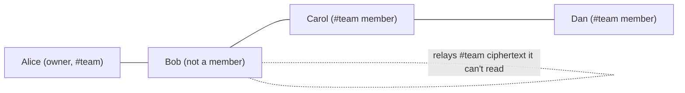

# Mesh Channels, Relaying and Group Encryption — Research Report

Follows on from [08_OFFLINE_BLE_MESH_IMPLEMENTATION_PLAN.md](08_OFFLINE_BLE_MESH_IMPLEMENTATION_PLAN.md). Scope: **BLE mesh chat only**. Text Chat, Voice and the backend are not touched.

---

## 0. Where the current plan stands

| Phase | State | What's left |
| :--- | :--- | :--- |
| 0 — Capacitor wrap | 🟡 | Test the APK on a phone: login, chat, voice still work like the website |
| 1 — Mesh logic in browser | ✅ | — |
| 2 — Android BLE plugin | ✅ | — (verified on two phones, 2026-10-27) |
| 3 — Multi-hop + late delivery | ✅ | — (3-phone line test passed, 2026-10-29) |
| 4 — iOS plugin | ✅ | — (Mac build + iPhone ↔ Android passed, 2026-10-29) |
| 5 — Security | ⬜ | 5a: encrypted DMs, `DM`/`ACK` packets, DM outbox, padding, fingerprint screen, panic wipe. 5b: Noise XX |
| 6 — Upload history when online | ⬜ optional | `mesh_messages` table + `POST /api/mesh/sync` |
| 7 — Battery + reliability | ⬜ | Scan cycling, low-battery mode, relay counter |
| Later | ⬜ | `SYNC` via Bloom filter instead of an ID list |

**This report changes the plan.** Channels (§2–4) and channel encryption (§5) come *before* Phase 5 DMs, because DMs reuse the same key-distribution pieces. The proposed new order is in §8.

---

## 1. The problems with what we have now

1. **One global room.** Every phone in range is in the same chat. There's no way to make a group.
2. **History goes to everyone.** `SYNC` hands the full local history to any phone that connects.
3. **Nothing is private.** Public messages are signed, not encrypted — fine for a lobby, not for a group.
4. **Open question:** if a person "owns" a channel, does the channel only reach people in *their* radio range (like an SFU with one server)?

---

## 2. Main decision: a channel is a *topic on the mesh*, not a *server*

**Answer to problem 4: no phone should be the channel's server.** Every phone relays every packet, for every channel, whether it's a member or not. A channel is just a tag on packets.

This is how the working systems do it:

| System | Radio | How channels work | Who relays |
| :--- | :--- | :--- | :--- |
| **Meshtastic** | LoRa | Channel = name + pre-shared AES key (PSK). Default public channel uses a well-known key. | Every node rebroadcasts every packet (managed flooding), even for channels it can't decrypt |
| **Bitchat** | BLE | Public mesh room + `#channels`, optionally password-protected (key derived from the password). Later added location channels over Nostr when online. | Every node relays; Noise XX for private DMs |
| **Briar** | BLE/Wi-Fi/Tor | Private groups and forums. Messages are signed and synced between contacts. | Only contacts sync with each other; private groups sync **through the creator by default** — if the creator is offline, members often don't get messages. *This is the "SFU problem" — avoid it.* |
| **Bridgefy** | BLE | Broadcast + DMs. | Every node. Broken by researchers in 2020 (Albrecht et al., "Mesh Messaging in Large-scale Protests") — lesson: don't invent crypto, sign everything, don't leak the social graph. |

**What we do:**

- **Relaying stays exactly as today** (flood, TTL 7, dedup, jitter, rate limit). The router doesn't need to know channel membership to forward. Non-members just forward bytes they can't read.
- **Delivery is filtered by channel.** The router delivers a packet to the UI only if I'm in its channel.
- **History/sync is per channel, from any member.** A late joiner gets history from *whichever* member is nearby, not from the owner. The owner only matters for admin actions (invite, kick, key change), and can name other admins.
- **Every phone is also a carrier ("store for others").** Optional: keep a small cache of *ciphertext* for channels I'm not in, and hand it on during `SYNC`. This is what makes messages hop across gaps in the crowd. Budget it (e.g. 1 MB / 6 h) so it can't fill the phone.

So yes to "each participant acts as server to others, a scanner, and a relay for other things" — but **all phones, equally**, not one owner per channel.

Alice's message reaches Dan through Bob and Carol. If Alice leaves, Carol can still give Dan the #team history.

---

## 3. Channel discovery ("scan shows channels near me")

**BLE advertising can't carry channel lists.** A legacy advertisement is 31 bytes, iOS can't put service data in it at all, and iOS hides even the service UUID in the background. Putting channel names in adverts would also tell any passer-by with a scanner app what groups exist.

**So discovery happens one layer up, over the mesh:**

1. The radio keeps doing what it does now: find *any* phone running the app and link to it.
2. New packet **`CHANNEL_ANNOUNCE`**, flooded every ~60 s by members of *discoverable* channels (one member per channel per minute is enough — suppress if you heard someone else announce it recently):
   `channelId (16 B) · name · kind · ownerKey · memberCountHint · lastActivity`, signed by the channel key.
3. The **Channels** screen lists every channel heard in the last ~5 minutes, with hop distance. Tap → join (open channel) or request to join (private channel).

**Channel kinds:**

| Kind | Who sees it in the list | Who can read | Encryption |
| :--- | :--- | :--- | :--- |
| **Lobby** (built-in) | Everyone | Everyone | None, signed only. Short history (e.g. 50 msgs / 1 h) |
| **Public** | Everyone | Anyone who joins | None, signed only |
| **Password** | Everyone (shows a lock) | Anyone who knows the password | Key from Argon2id(password, channelId). Simple, but a weak password can be guessed offline by anyone who captures packets |
| **Private** | Members only — or listed as "invite-only" if the owner wants | Members given the key | Group key (§5) |
| **Hidden** | Nobody (never announced) | Members only | Group key; join only by invite / QR |

**Channel ID:** first 16 bytes of SHA-256 of the channel's Ed25519 public key. The channel key pair is made by the creator and signs the channel's announce and admin packets.

---

## 4. Packet and storage changes

Small, additive changes to the current format (§6 of plan 08):

- **flags bit3 `encrypted`** (already reserved), **bit4 `has channel`**.
- **`channelTag` 16 B** after `recipientId` when bit4 is set.
  - Public/password channels: tag = channelId.
  - Private/hidden channels: tag = `HMAC(epochKey, channelId ‖ hour)` truncated to 16 B, so relays and outsiders can't tell two messages belong to the same private channel, and it changes every hour. Members compute it to match.
- **New types:** `CHANNEL_ANNOUNCE`, `JOIN_REQUEST`, `KEY_GRANT` (keys sealed to one member), `EPOCH_CHANGE`, `MEMBERS` (signed member list), plus `DM`/`ACK` from Phase 5.
- **`SYNC` becomes per channel:** `[channelTag][message IDs or Bloom filter]`. You only ever sync channels you're in, plus (optionally) the carrier cache.
- **Store:** messages keyed by channel; retention per channel (owner sets it). The current global history becomes the **Lobby** channel.

Header overhead today is ~54 B + 64 B signature. +16 B for the tag is fine.

---

## 5. Encryption for channels — the "key changes when people join" problem

### 5.1 The options

| | How it works | New member reads old messages? | Removed member locked out? | Cost on mesh | Fits offline mesh? |
| :--- | :--- | :--- | :--- | :--- | :--- |
| **A. One fixed key** (Meshtastic PSK, Bitchat password) | Everyone has the same key forever | Yes, all | **No**, never | Tiny | Yes, but no way to kick anyone |
| **B. Epoch keys** *(recommended)* | Channel key with a version number. Admin seals the current key to each member's X25519 key. New epoch on **remove**, not on join | **Yes** — admin also hands over old epoch keys, per channel policy | Yes, from the next epoch | One `KEY_GRANT` per member on change (~100 B each) | **Yes** |
| **C. Sender Keys** (Signal / WhatsApp groups) | Each member has their own chain key, sent pairwise to every other member. Ratchets per message | Not by default (forward secrecy) | Yes, but *everyone* must re-send their key | O(n²) messages on changes | Hard — needs every pair to reach each other |
| **D. MLS** (RFC 9420) | Tree of keys, O(log n) updates, forward secrecy + healing after compromise | Not by default | Yes | Small | **Not yet.** MLS needs one agreed order of changes (a server). Decentralised versions (DMLS drafts, 2025) are still IETF drafts |

### 5.2 Recommendation: epoch keys (B), the "Matrix Megolm" idea adapted to the mesh

**The key insight: you don't need a new key when someone joins.** Rotating on join is only for *hiding* history from newcomers — the opposite of what we want. So:

- **Join** → keep the same epoch. An admin sends the newcomer a `KEY_GRANT`: the current epoch key **plus the older epoch keys** that the channel's history policy allows. The newcomer can now decrypt the history they sync from any member. Nothing is re-encrypted.
- **Leave / kick** → admin makes **epoch N+1**, seals it to each remaining member (`KEY_GRANT`s), and floods a signed `EPOCH_CHANGE`. The removed person keeps what they already saw but can't read anything new.
- **Periodic rotation** (e.g. every 24 h or 500 messages) limits how much one leaked key exposes.

**History policy per channel** (same idea as Matrix's history visibility):
- `full` — newcomers get all epoch keys still in retention.
- `since-invite` — only the current epoch.
- `none` — rotate on join too (newcomers see only new messages).

**Per-message keys:** `messageKey = HKDF(epochKey, messageId)` → XChaCha20-Poly1305 (`@noble/ciphers`, already planned). Nonce reuse is impossible because message IDs are unique per message.

**Signing:** keep the outer Ed25519 signature so relays can still drop forgeries and rate-limit per sender. Trade-off: the sender's key is visible to relays. If that's not OK for a channel, move the sender key and signature *inside* the ciphertext — then relays can't verify, so spam protection falls back to per-link rate limits. Make this a per-channel setting later; default to outer signature.

### 5.3 Problems specific to an offline mesh, and the fixes

| Problem | Fix |
| :--- | :--- |
| Admin offline when someone wants to join | Any admin can grant. Owner can make more admins. Join requests wait in the outbox until an admin is in range |
| Mesh splits into two halves during a key change | Members keep the last ~3 epoch keys and accept messages from any of them. Messages say which epoch they use |
| Two admins change the epoch at the same time | Deterministic rule: higher epoch number wins; on a tie, the lower hash of the `EPOCH_CHANGE` wins. The losing admin re-grants on the winner's epoch |
| A member never got the new key | They see "N messages waiting for a key" and send `JOIN_REQUEST` again; any admin re-sends the grant |
| Joining with no mesh path to an admin | **QR invite in person**: the QR contains channelId + current epoch key sealed to nothing (it's shown face-to-face) or a one-time invite secret. Works fully offline |
| Kicked member still relays | That's fine — they relay ciphertext they can't read |

### 5.4 Why not MLS now

MLS is the "right" long-term answer (forward secrecy and recovery after a phone is stolen), but it assumes one agreed order of group changes. On a mesh that splits and merges, two halves can make conflicting changes and the group breaks. The DMLS drafts tackle this, but they're not finished and cost some forward secrecy. **Revisit after the epoch design ships**; the `KEY_GRANT` / `EPOCH_CHANGE` packets could later carry MLS messages instead.

---

## 6. Relaying at scale — what to measure and tune

Flooding works well up to a few dozen phones and starts to hurt in the hundreds (each phone has ~7 links and a few KB/s). Options, in order of effort:

1. **Keep today's limits** (TTL 7, 20 pkt/s, jitter). Add per-channel TTL (a local channel can use TTL 3).
2. **Duplicate suppression:** if during the 10–80 ms jitter I hear the same packet from ≥2 other links, skip my relay (each neighbour probably covered it). Meshtastic does a version of this with signal strength.
3. **Priority queue:** my own + my channels' packets first, then DMs, then carrier traffic, then announces.
4. **Set reconciliation for `SYNC`** (Bloom filter, later range-based like Negentropy) so catch-up costs bytes proportional to *what's missing*, not to history size.

---

## 7. Research plan (questions to answer before/while building)

| # | Question | How we answer it | Output |
| :--- | :--- | :--- | :--- |
| R1 | How do Bitchat channels and its relay/store-and-forward actually work today? | Read Bitchat whitepaper + source (Swift/Android) | Notes; borrow what fits |
| R2 | Meshtastic channel + rebroadcast rules | Read Meshtastic firmware docs on channels, encryption, managed flooding | Duplicate-suppression rule for §6.2 |
| R3 | Matrix Megolm key sharing + history visibility | Read Matrix spec | Final shape of `KEY_GRANT` and history policy |
| R4 | Is DMLS usable yet? | Track `draft-kohbrok-mls-dmls`, `draft-xue-distributed-mls`, OpenMLS support | Go/no-go for MLS later |
| R5 | How much traffic does flooding cost with N channels? | Extend the 20-node simulation: 50 and 200 nodes, 5 channels, measure packets/node/min | Numbers for §6 limits |
| R6 | Real BLE throughput per link and per phone | 3–5 real phones, measure KB/s and delay per hop | Budget for announces and sync |
| R7 | Key change across a split mesh | Simulation: split mesh, change epoch on one side, merge | Confirm §5.3 rules converge |
| R8 | Privacy of private-channel tags | Review: can a relay link messages over time? | Confirm hourly HMAC tag is enough |

---

## 8. Proposed build order

Device tests for Phases 2–4 are done. The detailed build plan for these steps is [10_MESH_CHANNELS_IMPLEMENTATION_PLAN.md](10_MESH_CHANNELS_IMPLEMENTATION_PLAN.md). Summary:

| Step | What | Done when |
| :--- | :--- | :--- |
| **C1 — Channels (plaintext)** | Channel ID, `CHANNEL_ANNOUNCE`, Channels screen, join/leave, per-channel delivery, per-channel `SYNC` and retention; global room becomes Lobby | In a 3-tab sim, a #test message reaches only #test members, but non-members still relay it; a late joiner gets #test history from a non-owner |
| **C2 — Password channels** | Argon2id key, encrypted flag, encrypt/decrypt | Relay tab logs show ciphertext only |
| **C3 — Private channels** | Epoch keys, `KEY_GRANT`, `EPOCH_CHANGE`, `MEMBERS`, admins, history policy, QR invite, hourly tags | Kicked tab can't read new messages; newcomer reads history per policy; split-and-merge sim converges |
| **C4 — Carrier cache + relay tuning** | Store-for-others budget, duplicate suppression, priority queue | 50-node sim delivers ≥99% with less relay traffic than today |
| **C5 — Internet bridge** (replaces plan 08's Phase 6) | When a phone has internet, it forwards its channels' packets (still encrypted) to a small relay, so separate mesh groups far apart (different cities or countries) share the same channels. The relay only sees ciphertext. No internet → mesh keeps working locally; messages wait | Two mesh groups with no Bluetooth path between them exchange #team messages through the bridge; a relay log shows ciphertext only |
| **Phase 5 DMs** | Reuse sealed-box code from `KEY_GRANT`; then Noise XX | As in plan 08 |
| Phase 7 | Unchanged | As in plan 08 |

**Channel rules when people get separated:** a channel lives on every member's phone (ID, keys, history), not on one device or place. A member who goes out of range keeps all of it; messages they write wait in the outbox and go out on the next path back (a nearby phone, the bridge, or someone carrying messages). The channel is never closed or taken over while members are away; if the owner never returns, the other admins keep running it.

---

## Sources

- Bitchat overview and whitepaper summaries: [DEV Community](https://dev.to/grenishrai/offline-messaging-reinvented-with-bitchat-5011), [bitchat on PyPI](https://pypi.org/project/bitchat), [Hackaday security review](https://hackaday.com/blog/page/474/?cat=VCT)
- Meshtastic channels and rebroadcast (third-party implementation readme): [espp/meshtastic](https://components.espressif.com/components/espp/meshtastic/versions/1.3.9/readme)
- Briar: [Protocol stack overview](https://code.briarproject.org/briar/briar/wikis/A-Quick-Overview-of-the-Protocol-Stack), [Private Group Client spec](https://code.briarproject.org/briar/briar-spec/-/blame/master/clients/Private-Group-Client.md), [Private group messaging issue](https://code.briarproject.org/briar/briar/issues/658), [Manual issue on groups vs forums](https://code.briarproject.org/briar/briar-manual/-/issues/12)
- Decentralised MLS: [draft-xue-distributed-mls-02](https://www.ietf.org/archive/id/draft-xue-distributed-mls-02.html), [draft-kohbrok-mls-dmls-01](https://potaroo.net/ietf/ids/draft-kohbrok-mls-dmls-01.html), [datatracker](https://datatracker.ietf.org/doc/html/draft-xue-distributed-mls)
- From background knowledge, to check during R1–R4: Bitchat's later Nostr location channels, Meshtastic managed flooding details, Matrix Megolm / history visibility, the 2020 Bridgefy break (Albrecht et al.).
